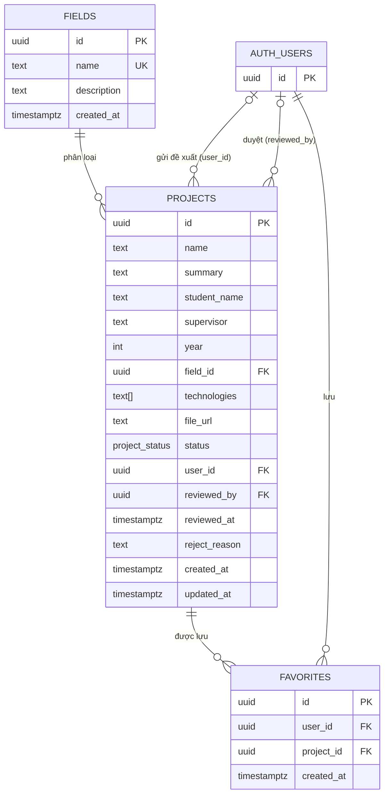

# Sơ đồ ERD

Ghi chú ràng buộc: `FIELDS.name` là duy nhất; cặp `(FAVORITES.user_id, FAVORITES.project_id)` có ràng buộc duy nhất. `PROJECTS.status` dùng kiểu enum `public.project_status`; `PROJECTS.year` nằm trong khoảng 2000–2100; nếu trạng thái là `rejected` thì `reject_reason` phải có nội dung. `PROJECTS.technologies` có kiểu PostgreSQL `text[]`.

## Mô tả

- **FIELDS**: lưu các lĩnh vực dùng để phân loại đồ án.
- **PROJECTS**: lưu thông tin đồ án, lĩnh vực, trạng thái duyệt và thông tin người gửi/người duyệt.
- **FAVORITES**: liên kết người dùng với các đồ án họ lưu yêu thích; mỗi người dùng chỉ lưu một lần mỗi đồ án.
- **AUTH_USERS**: biểu diễn `auth.users` của Supabase để thể hiện các khóa ngoại người dùng. `auth.users` do Supabase Auth quản lý, không được tạo bởi các migration này.

RLS đã bật trên `fields`, `projects` và `favorites`. Hai migration phân quyền
trong thư mục `supabase/migrations/` tạo policy cho `fields`, `projects` và
`profiles`; chính sách `favorites` nằm ngoài phạm vi chức năng này.
